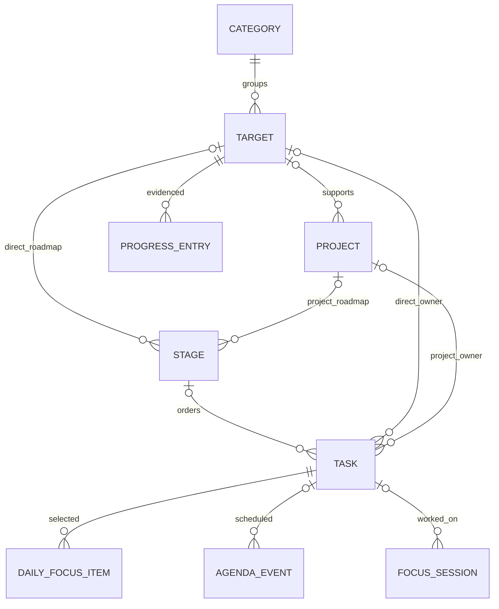

# Arsitektur MyLife v2

Tanggal: 26 Oktober 2026. Status: rancangan implementasi bertahap. Lihat SYSTEM_AUDIT_2026-10-26.md untuk keadaan aktual.

## 1. Pilihan arsitektur

Pertahankan aplikasi **lokal modular per fitur**. UI membaca melalui hook, hook menjalankan aturan fitur melalui repository, repository memakai Drizzle/SQLite. Tidak memerlukan microservices, backend, event bus, atau kerangka dependency injection untuk satu pengguna pada satu perangkat.

Pisahkan aturan bisnis murni yang dipakai lintas alur—tanggal, progres, status—dari komponen. Tambahkan application service hanya untuk operasi yang benar-benar mengoordinasikan beberapa repository/efek, misalnya finalisasi sesi dan restore; jangan membuat satu wrapper untuk setiap fungsi CRUD.

Expo Router tetap satu-satunya navigasi. Versi yang diaudit: Expo ~58.0.19, React Native 0.88.0, React 19.3.0, Drizzle 0.45.4. Verifikasi dokumentasi versi sebelum menyentuh API, jangan menyalin contoh SDK lama dari dokumen sejarah.

## 2. Struktur yang dipertahankan

```text
src/app/                         adapter route/layout saja
src/features/<fitur>/
  domain/entities/               tipe dan aturan murni
  domain/repositories/           kontrak yang sudah dipakai
  data/repositories/             query dan transaksi lokal
  data/services/                 efek perangkat jika dibutuhkan
  presentation/hooks/            loading/error/action state
  presentation/components/       UI fitur
  presentation/screens/          komposisi layar
src/shared/ui/                   primitive UI bersama
src/shared/                      helper domain-netral yang benar-benar dibagi
src/theme/                       warna, tipografi, spasi, radius, gerak
src/db/                          koneksi, schema, migrations berversi
```

Fitur baru `reviews`/bukti hasil baru dibuat ketika irisan R2 dikerjakan. Jangan membuat folder kosong/use case spekulatif. Dua repository lama di `src/db/repositories/` dihentikan setelah pemeriksaan pemakai. Komponen starter ditinjau pemakainya sebelum dibuang; jangan hapus aset karena tampak tidak relevan.

## 3. Model hubungan yang dituju



Catatan: diagram tidak menyatakan semua relasi opsional boleh terisi sekaligus. Constraint berikut wajib:

- Kategori adalah pengelompokan utama target; pilar legacy dipertahankan selama migrasi dan tidak menjadi input wajib kedua.
- Stage mempunyai tepat satu parent: target_id atau project_id, keduanya foreign key nyata. Ini menggantikan parent_type/parent_id yang tidak dapat dijaga FK SQLite langsung.
- Task mandiri mempunyai kedua owner null; task milik target atau proyek mempunyai tepat satu owner. Task boleh tidak punya stage; jika punya stage, owner harus sama dengan stage, divalidasi dalam transaksi. Jangan mengisi targetId dari projectId sebagai salinan hubungan.
- Project.target_id opsional. Progres target memuat tugas langsung serta tugas proyek yang target_id-nya terkait; DISTINCT task.id mencegah hitung ganda.
- DailyFocusItem unik pada date + task_id; hanya pemilihan dan urutan. Status terkini dibaca dari task, bukan is_completed salinan.
- FocusSession dapat bertahan setelah tugas dihapus dengan task_id null dan label historis yang sesuai kebijakan penyimpanan; menit dihitung dari sesi valid, bukan angka UI sementara.
- Agenda dapat berdiri sendiri atau merujuk tugas. Link target/proyek legacy tidak dihapus sebelum maknanya dimigrasikan; hindari tiga link yang saling bertentangan.
- ProgressEntry pada R2 berisi target_id, waktu, catatan dan link bukti opsional. Link tidak dieksekusi otomatis dan divalidasi sebelum dibuka.
- WeeklyReview pada R2 menyimpan awal minggu lokal, pencapaian, hambatan, next action; tidak perlu relational link ke setiap item karena ringkasan aktivitas bisa diquery.

## 4. Konsolidasi data tanpa kehilangan riwayat

Pilih `title`, `estimated_minutes`, dan satu enum status persist sebagai bentuk utama tugas. Kolom name/estimated_hours/is_completed serta status DONE hanya jalur kompatibilitas selama migrasi. Definisikan prioritas URGENT secara konsisten atau petakan eksplisit ke HIGH; jangan tampilkan URGENT sebagai “Santai”.

Milestone lama harus dipetakan ke Stage berdasarkan project_id dan sort_order. Tugas milestone dipindah ke stage yang sesuai. Jika data mempunyai stage_id sekaligus milestone_id, pilih aturan resolusi, simpan catatan konflik, dan jangan menghancurkan salah satu hubungan diam-diam. Life pillars lama dipetakan ke kategori berdasarkan data aktual; target null tidak semuanya dianggap karier tanpa persetujuan pemaknaan data.

Ini pekerjaan migrasi data, bukan mengganti nama file/tipe saja. Tunda drop kolom/tabel sampai fixture lama, pemulihan cadangan, dan query versi baru sudah lolos.

## 5. Kebijakan integritas dan penghapusan

Gunakan foreign key aktual dengan PRAGMA ON pada setiap koneksi, transaksi untuk perubahan majemuk, dan CHECK untuk nilai yang bisa diperiksa dalam satu row. Stage ownership lintas row memerlukan validasi aplikasi/trigger yang diuji; TypeScript saja tidak menegakkan data lama atau import.

Untuk tugas yang benar-benar dihapus: daily focus cascade, sesi set null, agenda mempertahankan event tetapi melepaskan task link. Saat stage dihapus, UI menjelaskan tugas yang ikut dihapus; hapus stage+tugas dalam satu transaksi. Menghapus target melepas hubungan proyek yang dipertahankan, menghapus roadmap langsung setelah konfirmasi, dan mempertahankan riwayat sesuai aturan di atas. Arsip menjadi pilihan utama untuk tujuan/proyek yang sudah berisi histori.

Jangan membuat soft delete pada semua tabel tanpa kebutuhan sinkronisasi. Status arsip pada aggregate yang dibutuhkan cukup untuk rilis lokal; sinkronisasi cloud kelak memerlukan desain konflik, identitas perangkat, tombstone, dan keamanan tersendiri.

## 6. Strategi migrasi

1. Inventaris versi/kolom/constraint database aktual; deteksi data orphan dan kepemilikan ambigu.
2. Buat snapshot lengkap sebelum rebuild, verifikasi jumlah baris dan bahwa berkas dapat dibaca.
3. Gunakan nomor versi skema (`PRAGMA user_version` atau journal migrasi tunggal yang dipilih), dengan urutan migrasi deterministik.
4. Rebuild tabel constraint sesuai kemampuan SQLite; penonaktifan FK bila diperlukan dilakukan di luar transaksi yang relevan, dipulihkan dalam finally. Jangan menelan error migrasi kecuali keadaan telah diverifikasi.
5. Salin data dengan pemetaan eksplisit; untuk orphan/conflict, blok perubahan destruktif dan sediakan laporan pemulihan. Jangan menghapus orphan otomatis sebagai “pembersihan”.
6. Jalankan foreign_key_check, pemeriksaan jumlah/nilai penting, integritas skema, lalu commit dan tandai versi.
7. Jika gagal, startup masuk layar pemulihan/retry; jangan mount seluruh UI sebagai siap.

Uji minimal: instalasi bersih dari DDL saat ini; fixture skema sebelum kategori/tahapan; fixture dengan milestone dan tugas lama; upgrade terputus/gagal; upgrade ulang idempoten; kategori custom; data orphan. Database pengguna tidak disentuh oleh skrip audit.

## 7. Waktu dan tanggal

- Created/updated/session timestamps: ISO UTC yang dinormalisasi.
- Date-only untuk prioritas, deadline harian dan review: YYYY-MM-DD lokal. Jangan membuatnya dengan UTC slicing.
- Query hari lokal: buat awal hari dan awal hari berikutnya dalam zona yang dipakai aplikasi, konversi ke instant UTC, gunakan batas akhir eksklusif. Ini juga perlu benar saat DST untuk kompatibilitas lintas wilayah.
- All-day event: tanggal awal dan tanggal akhir eksklusif; jangan disamakan dengan 24 jam UTC.
- Event berwaktu: instant UTC; tentukan kebijakan saat pengguna bepergian. Rilis awal menampilkan zona perangkat dan menginformasikan perubahan; recurrence kelak perlu zona IANA tersimpan.
- Reload date state saat app kembali aktif atau melewati tengah malam; strip kalender tidak boleh memegang “hari ini” yang memoized selamanya.

## 8. Timer dan efek perangkat

Persist satu sesi aktif dengan sessionId, mode, taskId, startedAt, elapsed aktif, target waktu selesai dan status RUNNING/PAUSED/COMPLETED/CANCELLED. Implementasi dapat memakai tabel sesi dengan kolom lifecycle yang diperlukan; jangan memasukkan model timer berbeda ke tiga store.

Sisa waktu berasal dari timestamp, bukan jumlah tick. Jadwalkan notifikasi OS untuk countdown; pause/reset membatalkannya; kembali aktif menghitung ulang. Proses mati lalu dibuka harus bisa memulihkan sesi. Finalisasi memakai sessionId unik agar resume/retry tidak menggandakan catatan. Memindah task/mode tidak boleh mengalihkan menit sesi sebelumnya ke tugas baru.

Sesi disimpan sebelum dialog refleksi. Menutup dialog hanya melewati refleksi. Preferensi haptics/keep awake dibaca dan dihormati; cleanup melepas keep-awake. Stopwatch perlu aksi selesai eksplisit, bukan tombol reset yang membuang seluruh aktivitas tanpa penjelasan.

Notifikasi adalah efek setelah transaksi DB. Kegagalan izin/scheduler dilaporkan sebagai reminder belum aktif, bukan kegagalan menyimpan agenda. Lakukan rekonsiliasi reminder ketika jadwal diubah/dibuka kembali; verifikasi kemampuan SDK/build nyata. Jangan mengklaim alarm tepat di semua kondisi OS sebelum diuji.

## 9. Query dan state UI

SQLite menjadi sumber kebenaran. State hook memuat snapshot untuk rendering; lakukan refresh saat layar kembali fokus dan setelah mutasi. Request lama harus diabaikan bila filter/ID berubah. Jangan menambahkan salinan seluruh database di Zustand hanya untuk invalidasi.

Query detail mengambil ID yang diminta. Summary memakai count/sum/join di SQL; indexing mengikuti WHERE/join aktual. Maksimal lima prioritas bukan alasan membaca seluruh backlog. Gunakan list virtual dan pagination ketika daftar benar-benar panjang; profile dengan fixture sebelum mengklaim target performa.

## 10. Backup, restore, dan privasi

Snapshot seluruh tabel dalam pembacaan yang konsisten; envelope menyertakan formatVersion, schemaVersion dan exportedAt. Restore memvalidasi ukuran, bentuk, tipe, ID unik, enum, tanggal, kepemilikan, dan relasi sebelum menyentuh DB aktif. Lakukan preview ringkas dan pilih ganti data secara jelas; merge multi-sumber ditunda.

Restore ke database sementara, verifikasi integritas/jumlah baris, lalu lakukan pergantian yang aman dengan opsi kembali. Jangan menjalankan SQL dari berkas import. Batasi file/teks yang diproses agar tidak menghabiskan memori. Jangan mengirim snapshot ke log atau cloud. Ekspor berkas pribadi dilakukan oleh aksi pengguna melalui mekanisme platform yang diverifikasi.

Penyimpanan lokal bukan sinonim enkripsi. Kebijakan backup OS, file JSON, dan perlindungan perangkat perlu ditinjau sebelum menyimpan catatan sensitif; aplikasi tidak mengklaim enkripsi yang belum diimplementasikan.

## 11. Strategi uji

Unit/domain: status, DISTINCT rollup, penghitungan progres, hari lokal, validasi jam/nilai. Integrasi SQLite: FK, cascade/set null, transaksi gagal/rollback, restore round-trip, migrasi fixture lama. Timer: clock terkontrol untuk pause/resume/ganti mode/restart dan idempotensi. UI: satu alur target→tugas proyek→Hari Ini→Agenda→selesai→ringkasan di Android.

Native QA: keyboard, tombol kembali, safe area/gesture nav, font 200%, TalkBack, izin notifikasi ditolak, app background/Doze/proses dimatikan. Lint/tsc adalah gerbang dasar, bukan pengganti uji perilaku.
