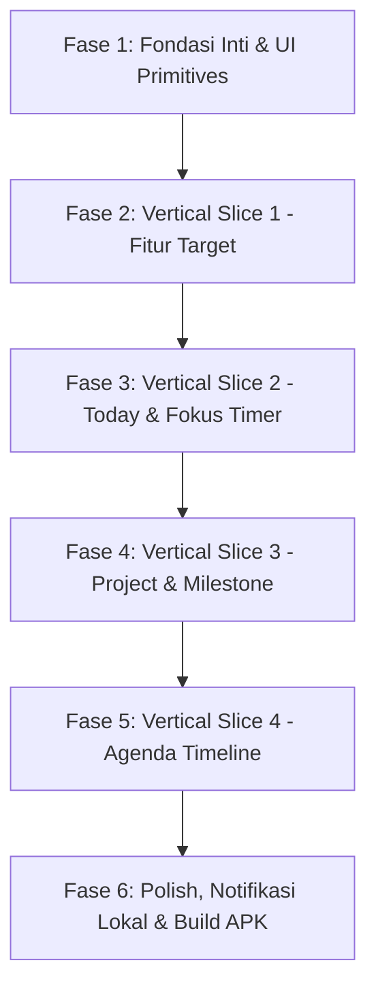

# PROJECT_PROFILE.md — MyLife Mobile (Personal Life OS)

> **Status:** Active Project Definition & Single Source of Truth Alignment  
> **Platform:** Android APK (Primary) / Mobile (React Native + Expo SDK 58)  
> **Arsitektur:** 100% Offline-First / Local-First (SQLite via Drizzle ORM)  
> **Design Language:** Light, Indigo Puffy (primary #4C4DCC, highlight #FFA268, latar #FCF8FD, Plus Jakarta Sans, radius 16/28) sesuai `docs/DESIGN.md` dan referensi UI "Kawan Tracker" (tanpa maskot)  

---

## 1. Hakikat Produk: Apa itu "MyLife Mobile"?

MyLife Mobile adalah **Personal Life Operating System (Personal Life OS)** di saku pengguna yang dirancang untuk menghilangkan friksi akses web (*accessibility friction*) dengan kecepatan buka instan (< 1.5 detik), 100% dapat digunakan tanpa koneksi internet, serta ramah penggunaan satu tangan (*one-handed thumb zone*).

Aplikasi ini **bukan sekadar to-do list biasa**, melainkan ekosistem pencapaian hidup berjenjang:
```
┌────────────────────────────────────────────────────────────────────────┐
│ 1. TARGET (Kompas Hidup Utama)                                         │
│    5 Pilar Kehidupan (Karier, Finansial, Kesehatan, Diri, Sosial)      │
│    Target Angka (Metric) / Babak (Milestone-based) / Pemeliharaan      │
└───────────────────────────────────┬────────────────────────────────────┘
                                    │ memandu & dipecah ke
                                    ▼
┌────────────────────────────────────────────────────────────────────────┐
│ 2. PROJECT (Wadah Eksekusi Terstruktur)                                │
│    Inisiatif spesifik dengan Milestone (babak kerja) & Kumpulan Tugas  │
└───────────────────────────────────┬────────────────────────────────────┘
                                    │ dijadwalkan & dieksekusi di
                                    ▼
┌───────────────────────────────────┴────────────────────────────────────┐
│ 3. TODAY & FOKUS (Cockpit Eksekusi Harian Terpadu)                     │
│    Top 3-5 Prioritas Hari Ini + Timer Fokus (Pomodoro & Deep Work)     │
│    Fitur HP: Layar Terjaga (Keep-Awake), Getaran (Haptics), Audio Chime│
└───────────────────────────────────┬────────────────────────────────────┘
                                    │ dialokasikan pada
                                    ▼
┌────────────────────────────────────────────────────────────────────────┐
│ 4. AGENDA (Timeline Kronologis Waktu)                                  │
│    Kegiatan Terikat Jam (Time-blocked) + To-Do Fleksibel Bebas Jam     │
└────────────────────────────────────────────────────────────────────────┘
```

---

## 2. Matriks Dokumen Acuan (Sumber Kebenaran)

| Aspek Pekerjaan | Dokumen Acuan Wajib | Peran & Isi Utama |
|---|---|---|
| **Kebutuhan Produk & Fitur** | [docs/prd.md](file:///d:/IT/Software%20Engineer/mobile/MyLife/docs/prd.md) | Visi, batasan fitur 4 pilar, flow mobile, user journey harian. |
| **Arsitektur Sistem & Hardware** | [docs/architecture.md](file:///d:/IT/Software%20Engineer/mobile/MyLife/docs/architecture.md) | Local-First, Delta Timestamp Timer Pomodoro (tahan Doze mode), hardware integration. |
| **Pola Layer & Struktur Folder** | [docs/MOBILE_ARCHITECTURE_TEMPLATE.md](file:///d:/IT/Software%20Engineer/mobile/MyLife/docs/MOBILE_ARCHITECTURE_TEMPLATE.md) | Feature-First, thin route adapters di `app/`, layer Presentation, Application, Domain, Data. |
| **Aturan Koding & Disiplin** | [docs/MOBILE_ENGINEERING_RULES_TEMPLATE.md](file:///d:/IT/Software%20Engineer/mobile/MyLife/docs/MOBILE_ENGINEERING_RULES_TEMPLATE.md) | Dilarang direct-DB di UI, strict typing, error handling terstandar, naming conventions. |
| **Skema Database & ERD** | [docs/database.md](file:///d:/IT/Software%20Engineer/mobile/MyLife/docs/database.md) | 9 tabel relasional SQLite, Foreign Key cascade, indexing performa 60 FPS, seed data 5 pilar. |
| **UI, UX, Layout & Desain Layar** | [docs/DESIGN.md](file:///d:/IT/Software%20Engineer/mobile/MyLife/docs/DESIGN.md) | **Satu-satunya acuan UI**: Deep Obsidian Teal, Template Layar A s/d E, zona jempol Hoober, target tap $\ge 48$ dp. |
| **Urutan Rilis Bertahap** | [docs/MOBILE_IMPLEMENTATION_ROADMAP_TEMPLATE.md](file:///d:/IT/Software%20Engineer/mobile/MyLife/docs/MOBILE_IMPLEMENTATION_ROADMAP_TEMPLATE.md) | Phased delivery, vertical slice testing, quality gates. |

---

## 3. Peta Template Layar (Berdasarkan `docs/DESIGN.md` Bagian 8)

Semua layar UI yang dibangun **wajib mengambil salah satu dari Template Layar berikut**:

- **Template A (Layar Tab Utama)**:
  - TopBar 64 dp (Judul `titleLarge`).
  - Maksimal 1 Kartu Hero (tinggi 124 dp, progres/angka besar).
  - Judul Seksi 48 dp (`titleMedium`).
  - Daftar Item / Kartu (tinggi item 56 / 72 dp dengan centang `CheckCircle` di kiri).
  - Floating Action Button (FAB 56 dp) di kanan bawah.
  - NavBar Bawah 64–80 dp.
  - *Diterapkan pada:* Tab Hari Ini, Tab Target, Tab Proyek, Tab Agenda.
- **Template B (Layar Detail Turunan)**:
  - TopBar 64 dp dengan tombol `‹ Kembali`, judul, dan menu `⋮` di pojok kanan atas (khusus aksi hapus/destruktif agar aman dari jangkauan tidak sengaja).
  - Blok judul + statistik 2 kolom (gap 12 dp).
  - Riwayat sesi / daftar tugas terkait.
  - *Diterapkan pada:* Detail Target, Detail Proyek & Board Milestone.
- **Template C (Layar Form Pembuatan / Ubah)**:
  - TopBar 64 dp dengan tombol `× Tutup`.
  - Field satu kolom, label selalu di atas field (bukan floating/placeholder).
  - **Bar Aksi Sticky Lebar Penuh (56 dp)** di bawah layar di atas keyboard ("Simpan"), netral tangan kiri & kanan.
  - *Diterapkan pada:* Form Tambah Target, Form Tambah Proyek, Form Tambah Tugas.
- **Template D (Layar Pengaturan)**:
  - TopBar 64 dp, kelompok seksi, list item 56/72 dp dengan Switch seketika.
  - *Diterapkan pada:* Pengaturan Durasi Pomodoro, Haptics, Cadangan Data.
- **Template E (State Kosong / Error / Loading Penuh)**:
  - Lingkaran ikon terstandar dengan warna pasangan `on...Container` (aturan revisi DESIGN.md).
  - Judul penjelasan + Deskripsi + Tepat 1 Tombol Aksi Utama.

---

## 4. Master Roadmap Menuju Final Project (Android APK)



### Rincian Milestone Kerja:

- [x] **FASE 1: Fondasi Inti, Arsitektur & Shared UI (SELESAI)**
  - Setup Expo SDK 58 + TypeScript Strict.
  - Setup NativeWind v4 + Deep Obsidian Teal theme tokens.
  - Setup Database SQLite + Drizzle ORM (DDL 9 tabel + seed 5 pilar).
  - Bangun Shared UI Primitives (`AppText`, `Button`, `Card`, `Screen`, `Banner`, `EmptyState`, `ProgressBar`).
  - Lolos uji: `npx expo-doctor` (20/20 passed) & `npx tsc --noEmit` (0 error).

- [x] **FASE 2: Vertical Slice 1 — Fitur TARGET (Fitur Utama & Kompas Hidup) (SELESAI)**
  - Domain & Entitas: `TargetEntity`, kalkulasi progres target.
  - Data Layer: `TargetRepositoryImpl` (query SQLite lokal).
  - Presentation: `TargetListScreen` (Template A), `TargetCard`, `PillarFilterChips`, `AddTargetModal` (Template C).
  - Route: Thin adapter `app/(tabs)/targets.tsx`.

- [x] **FASE 3: Vertical Slice 2 — Layar Terpadu: TODAY & FOKUS (SELESAI)**
  - Menggabungkan Top 3-5 Prioritas Hari Ini dengan Timer Fokus Pomodoro & Deep Flow dalam satu cockpit.
  - Delta Timestamp Engine (tahan Android Doze Mode).
  - Hardware integration: `expo-keep-awake` (layar tetap nyala), `expo-haptics` (getaran mulai/jeda/selesai), `expo-audio` (lonceng mangkuk meditasi).
  - Dialog refleksi pasca-sesi (skala 1-5 bintang, hambatan, auto-catat menit kerja ke database).
  - Route: Thin adapter `app/(tabs)/index.tsx`.

- [x] **FASE 4: Vertical Slice 3 — Fitur PROJECT & MILESTONES (SELESAI)**
  - Wadah eksekusi kerja spesifik pendukung Target.
  - Tampilan accordion milestone dan checklist tugas konkret.
  - Perhitungan otomatis persentase selesai tugas ke progres proyek dan target terkait.
  - Route: Thin adapter `app/(tabs)/projects.tsx` dan `app/projects/[id].tsx` (Template B).

- [x] **FASE 5: Vertical Slice 4 — Fitur AGENDA & JADWAL HARIAN (SELESAI)**
  - Timeline kronologis vertikal dengan pemisahan acara berwaktu dan tugas bebas jam (*all-day*).
  - Date strip header interaktif (14 hari) dengan penanda hari ini.
  - Kartu acara timeline dengan centang selesai di kiri (target sentuh $\ge 48$ dp), badge kategori warna pilar, dan konfirmasi hapus.
  - Form penjadwalan modal (Template C) lengkap dengan kategori kerja/rapat/belajar/pribadi, pengingat menit, dan lokasi.
  - Penjadwalan alarm pengingat lokal via `expo-notifications` (dengan izin sistem & pembatalan otomatis saat tuntas/dihapus).
  - Lolos uji: `npx expo-doctor` (20/20 passed) & `npx tsc --noEmit` (0 error).
  - Route: Thin adapter `app/(tabs)/agenda.tsx`.

- [x] **FASE 6: HARDENING, SETTINGS (TEMPLATE D), BACKUP/EXPORT & BUILD APK READINESS (SELESAI)**
  - Layar Pengaturan lengkap sesuai Template D (`docs/DESIGN.md` Bagian 8.4):
    - Switch getaran haptik & layar tetap terjaga (efek seketika).
    - Pemilih durasi Pomodoro (15, 25, 45, 60 mnt) & Deep Flow (45, 50, 60, 90 mnt).
    - Ekspor snapshot seluruh 9 tabel SQLite ke cadangan JSON dengan modal preview.
    - Ubin statistik database lokal (jumlah target, proyek, tugas, sesi fokus, agenda).
  - Konfigurasi Android APK produksi di `app.json`: package `com.mylife.mobile`, versionCode 1, izin Android (`WAKE_LOCK`, `VIBRATE`, `RECEIVE_BOOT_COMPLETED`, `SCHEDULE_EXACT_ALARM`), tema latar Deep Obsidian Teal `#081013`.
  - Konfigurasi `eas.json` dengan `buildType: "apk"` untuk menghasilkan installer `.apk` mandiri.
  - Lolos uji verifikasi penuh: `npx expo-doctor` (20/20 passed) & `npx tsc --noEmit` (0 error).
  - Route: `app/settings.tsx` dapat diakses dari tombol Pengaturan di header tab 'Hari Ini'.
