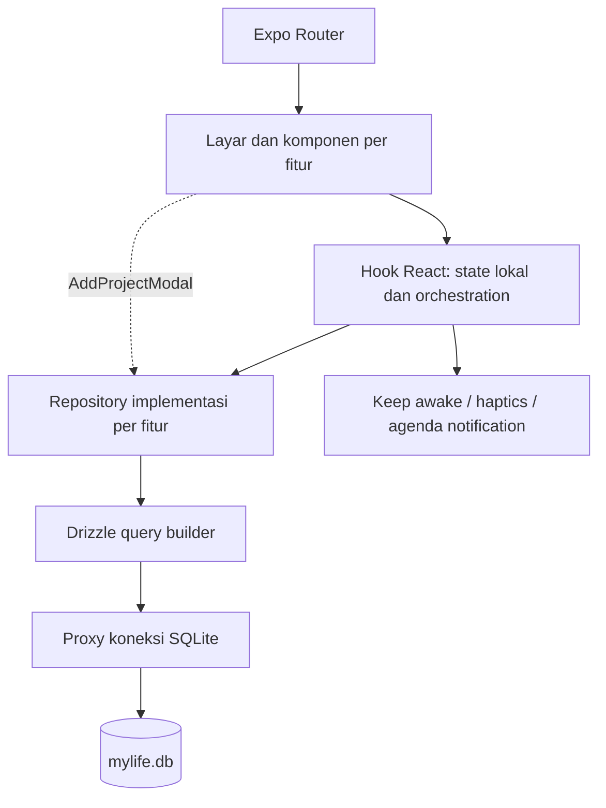

# Audit mendalam MyLife

Tanggal: 26 Oktober 2026. Status: audit sebelum implementasi. Semua referensi baris menunjuk kode saat audit.

## Apa yang sudah dibuat

MyLife adalah aplikasi pencatatan tujuan dan pelaksanaan harian secara lokal. Target dan Proyek mempunyai Tahapan dan Tugas; sebagian tugas dipilih untuk Hari Ini, timer mencatat sesi fokus, dan Agenda menyimpan kegiatan berwaktu atau sepanjang hari. Pengaturan menyimpan preferensi timer dan menampilkan snapshot JSON.

Asumsi beban: satu pengguna pada satu perangkat, digunakan berbulan-bulan atau bertahun-tahun; bukan layanan tim dengan banyak pengguna. Penilaian skalabilitas berfokus pada bertambahnya tugas/sesi dan kelancaran perangkat mobile, bukan kebutuhan server.

**Kesimpulan:** struktur dasar layak dipertahankan, tetapi belum matang sebagai sistem monitoring yang dapat dipercaya. Masalah utama ada pada integritas penyimpanan, perhitungan progres, lifecycle data, dan konsistensi UI. Menambah modul besar sekarang akan memperbanyak ketidakkonsistenan yang sudah ada.

## Peta kode aktual

- `src/app/`: 12 berkas route/layout; adapter layar, root init database/font, konfigurasi tab, detail target/proyek, pengaturan, quick add.
- `src/features/targets/`: daftar/detail target, kategori, ringkasan progres berbasis tugas.
- `src/features/projects/`: proyek opsional terkait target; ada jalur milestone lama dan tahapan baru.
- `src/features/stages/`: CRUD tahapan dan tugas; aturan status tahapan.
- `src/features/today-focus/`: pilihan maksimal lima tugas harian, timer, penyimpanan sesi/refleksi.
- `src/features/agenda/`: kegiatan, query tanggal, pengingat lokal; belum editor agenda atau pengaitan tugas dalam form.
- `src/features/categories/`: CRUD kategori, menolak hapus kategori yang dipakai target; saat ini akses pengelolaan melekat pada Target.
- `src/features/settings/`: preferensi dan snapshot JSON.
- `src/db/`: skema Drizzle, SQL pembentukan database/migrasi ad hoc, dua repository lama.
- `src/shared/ui/`: primitive tampilan yang sudah menjadi pusat reuse; `src/theme/` memuat token.
- `src/components/` + `src/constants/theme.ts`: masih ada komponen dan tema starter terpisah.
- `docs/`: visi awal, MVP, desain, arsitektur dan template; banyak klaim selesai tidak mencerminkan implementasi.

Terdapat 103 berkas di `src/` pada audit. Penelusuran mendalam dilakukan pada seluruh tujuh repository fitur, klien/skema database, hook inti, root/navigasi, shared UI, layar utama/detail/pengaturan, serta form dan kartu yang berhubungan dengan temuan. Ini audit berbasis risiko, bukan klaim membaca setiap aset dan setiap baris kode starter.

## Arsitektur yang benar-benar berjalan

Ini aplikasi modular per fitur dengan lapisan presentation/domain/data. Lapisan application terpisah, store Zustand aktif, validasi Zod, soft delete menyeluruh, sinkronisasi, dan layanan backup berkas belum ada. Jangan menambah lapisan hanya agar sesuai diagram lama.

## Database aktual

SQL aktual membentuk **11 tabel**, bukan sembilan: categories, life_pillars, targets, projects, stages, milestones, tasks, daily_focus_items, focus_sessions, agenda_events, user_settings.

Skema TypeScript mendeklarasikan relasi, tetapi DDL runtime tidak menuliskan `REFERENCES`. Relasi Drizzle tidak otomatis membuat constraint pada database. `PRAGMA foreign_keys=ON` tidak membantu jika tabel tidak mempunyai constraint.

Konsep yang tumpang tindih: kategori vs pilar, tahapan vs milestone, `title` vs `name`, `estimated_hours` vs `estimated_minutes`, `status` vs `is_completed`, serta status tugas di beberapa model. Saat ini kompatibilitas legacy sudah masuk ke logika inti tanpa proses konsolidasi yang jelas.

## Bukti yang dijalankan

Jalankan `node scripts/audit-system.cjs` dari root proyek. Skrip memakai SQL DDL dan repository aplikasi, TypeScript transpiler yang sudah terpasang, Drizzle SQLite proxy, serta SQLite in-memory Node. Tidak membuka database pengguna dan tidak menjalankan modul Expo native.

Hasil audit awal: 11 tabel, nol foreign key; link tugas tidak valid diterima; link harian tertinggal setelah proyek dihapus; tugas selesai dari tahapan proyek tidak masuk target; centang fokus harian tetap false saat tugas true; kategori/tahapan tidak ada di snapshot; event lintas tengah malam hilang dari query hari berikutnya; judul agenda kosong dan jam terbalik diterima; contoh tanggal 00:30 WIB terpotong menjadi tanggal UTC kemarin.

Hasil ini memvalidasi perilaku repository/SQL, bukan membuktikan perilaku modul SQLite native identik pada semua OS. Kasus lintas tengah malam pada harness memakai batas UTC agar dapat diulang tanpa bergantung zona host; perbaikan produksi tetap harus memakai batas hari lokal.

## Harus diperbaiki

### A01 — Relasi database tidak ditegakkan [P1, reproduksi]

- **Apa:** `src/db/client.ts:70` membentuk tabel; `src/db/schema.ts` mendeklarasikan foreign key yang dimaksud.
- **Masalah:** database baru mempunyai nol foreign key. Menambah `daily_focus_items.task_id` yang tidak ada berhasil; menghapus proyek menyisakan link fokus. Aturan cascade/set-null di skema tidak dijalankan.
- **Perbaikan minimum:** gunakan migrasi berversi untuk memasang constraint yang nyata; periksa orphan dan backup sebelum rebuild tabel lama. Tetapkan tindakan hapus untuk setiap relasi, termasuk tahapan polimorfik.
- **Jika ditunda:** riwayat dan penjadwalan memuat referensi mati; basis data semakin sulit dipulihkan. Jangan sekadar mengubah DDL baru dan menganggap database lama ikut berubah.

### A02 — Cadangan tidak lengkap dan belum dapat dipulihkan [P1, reproduksi + inspeksi]

- **Apa:** `src/features/settings/data/repositories/settings.repository.impl.ts:165` dan layar pengaturan menampilkan JSON.
- **Masalah:** `categories` dan `stages` tidak diekspor, padahal target/tugas mengacu kepadanya. Tidak ada alur import/restore; preview teks belum sama dengan file cadangan yang dapat diuji pulih.
- **Perbaikan minimum:** snapshot konsisten seluruh 11 tabel dengan versi skema, ekspor berkas, validasi import, lalu restore transaksional dan uji round-trip di database terpisah.
- **Jika ditunda:** pengguna mengira memiliki cadangan lengkap tetapi kehilangan kategori dan struktur roadmap saat mencoba memulihkan.

### A03 — Operasi beberapa penulisan tidak atomik [P1, inspeksi]

- **Apa:** delete target/proyek/tahapan, reorder tahapan, pembuatan quick task, dan penyimpanan sesi menulis beberapa baris secara terpisah. Contoh `target.repository.impl.ts:189`, `stage.repository.impl.ts:165`, `daily-focus.repository.impl.ts:154` dan `:197`.
- **Masalah:** jika penulisan berikutnya gagal, sebagian data sudah terhapus atau tersimpan. Quick task diinsert sebelum addFocusItem yang dapat menolak batas lima; sesi bisa tersimpan tanpa akumulasi menit tugas.
- **Perbaikan minimum:** transaksi dalam satu koneksi untuk setiap aksi bisnis; validasi batas terlebih dahulu dalam transaksi; penambahan menit memakai ekspresi SQL atomik. Tangani efek notifikasi setelah commit.
- **Jika ditunda:** hasil operasi sebagian jadi sulit dibedakan dari sukses; mencoba ulang dapat menggandakan sesi atau meninggalkan tugas tersembunyi.

### A04 — Hari lokal dan timestamp tercampur [P1, reproduksi]

- **Apa:** `use-today-focus.ts:10`, `use-agenda.ts:10`, `date-strip-header.tsx:27`; batas UTC di repository fokus `:243` dan agenda `:44`.
- **Masalah:** 26 Oktober 00:30 WIB menjadi `2026-10-25` ketika memakai `toISOString().split('T')[0]`. Form agenda berwaktu menyimpan string lokal tanpa offset, sedangkan all-day/query memakai Z; menit fokus pada dini hari dapat masuk laporan kemarin.
- **Perbaikan minimum:** date-only lokal untuk pilihan hari; timestamp absolut UTC untuk kegiatan berwaktu; query `[awal hari lokal, awal hari lokal berikutnya)` yang dikonversi UTC. Jangan memakai akhir hari `23:59:59` sebagai batas utama.
- **Jika ditunda:** prioritas, reminder, kalender, dan laporan tidak sepakat tentang tanggal yang sama. Uji WIB, WITA, WIT, dan perpindahan hari saat aplikasi tetap terbuka.

### A05 — Pekerjaan dalam proyek tidak ikut progres target [P1, reproduksi]

- **Apa:** `stage.repository.impl.ts:217` dan `target.repository.impl.ts:74`.
- **Masalah:** tugas dari tahapan PROJECT diberi projectId namun targetId null. Target hanya menghitung tugas dengan targetId langsung atau tahapan TARGET, sehingga satu tugas proyek yang selesai tetap menghasilkan total tugas target nol.
- **Perbaikan minimum:** query relasi proyek → target dalam agregasi, hitung DISTINCT task.id; tetapkan satu aturan kepemilikan agar perubahan target proyek juga benar tanpa backfill rapuh.
- **Jika ditunda:** pengguna menyelesaikan roadmap tetapi melihat target tidak maju. Ini langsung melanggar tujuan utama aplikasi.

### A06 — Status tugas mempunyai dua sumber kebenaran [P1, reproduksi]

- **Apa:** `daily-focus.repository.impl.ts:87` membaca centang dari focus item; `stage.repository.impl.ts:292` dan repository proyek mengubah tugas saja.
- **Masalah:** centang tugas dari Tahapan menjadi selesai, sementara Hari Ini masih belum selesai. Jalur Hari Ini mengubah dua tabel, jalur lain tidak; DONE/COMPLETED juga dinormalisasi berbeda.
- **Perbaikan minimum:** status tugas menjadi sumber kebenaran untuk tampilan terkini. Data harian menyimpan pemilihan/urutan; jika butuh riwayat historis, rekam event penyelesaian terpisah dengan makna eksplisit.
- **Jika ditunda:** hitungan, filter, dan tindakan toggle dapat membalik tugas yang sebenarnya sudah selesai.

### A07 — Pengaturan timer belum mengendalikan timer [P1, inspeksi]

- **Apa:** `use-focus-timer.ts:19`, `focus-timer-widget.tsx:76`, repository settings.
- **Masalah:** durasi 25/50 ditulis langsung di hook/widget; haptics dan keep-awake selalu diaktifkan tanpa membaca pengaturan. Pengguna mematikan getaran atau memilih 45 menit tetapi perilaku tetap lama.
- **Perbaikan minimum:** baca preferensi pada controller timer, gunakan durasi yang sama untuk label dan mesin; hormati toggle dan refresh saat kembali dari Pengaturan. Durasi sesi yang sedang berjalan tidak berubah diam-diam.
- **Jika ditunda:** pengaturan tampak berhasil tetapi tidak bisa dipercaya; timer juga dapat menjaga layar aktif ketika pengguna meminta sebaliknya.

### A08 — Riwayat fokus bergantung pada dialog sementara [P1, inspeksi]

- **Apa:** `use-focus-timer.ts:30`, `:46`, `:121`; `session-reflection-modal.tsx:42`; `use-today-focus.ts:92`; `today-focus-screen.tsx:287`.
- **Masalah:** sesi belum disimpan ketika timer selesai; menutup dialog membuang pencatatan. Simpan refleksi tidak menunggu Promise dan menutup walau DB gagal. Timer hanya berada di state/ref, jadi restart kehilangan sesi; ganti mode tidak mereset sessionStartTimeRef sehingga waktu mulai dapat berasal dari mode sebelumnya.
- **Perbaikan minimum:** identitas sesi stabil, simpan lifecycle timer, finalisasi idempoten saat selesai, refleksi mengedit sesi yang sudah ada. Tunggu hasil simpan, tampilkan error dan pertahankan isian. Reset waktu mulai saat membuang sesi atau mengganti mode.
- **Jika ditunda:** laporan waktu tidak lengkap atau salah waktu; retry bisa mencatat ganda. Ketahanan Doze dalam dokumen juga belum terpenuhi: hook timer belum menjadwalkan notifikasi OS.

### A09 — Agenda menerima rentang salah dan melewatkan event yang masih berlangsung [P1, reproduksi]

- **Apa:** `agenda.repository.impl.ts:42` dan `:59`; `add-event-modal.tsx:94`.
- **Masalah:** repository menerima judul kosong/jam terbalik; form mengganti input jam tidak valid menjadi 09:00/10:00 tanpa memberi tahu. Query overlap hanya untuk all-day; event berwaktu yang mulai kemarin dan masih berjalan hari ini hilang.
- **Perbaikan minimum:** validasi di batas repository serta pesan form dekat field; semua event berwaktu memakai overlap `start < dayEnd AND end > dayStart`. Bedakan tanggal sepanjang hari dari timestamp dan tetapkan batas akhir eksklusif.
- **Jika ditunda:** pengguna menyimpan jadwal yang berbeda dari inputnya atau melewatkan kegiatan malam yang masih berjalan.

### A10 — Pilihan pengingat “Tepat Waktu” tidak menjadwalkan apa pun [P1, inspeksi]

- **Apa:** `add-event-modal.tsx:35`, `use-agenda.ts:44`, `agenda-notification.service.ts:65`.
- **Masalah:** nilai 0 dilabeli Tepat Waktu tetapi ditolak oleh hook dan service. Saat agenda selesai lalu dibuka kembali, reminder yang dibatalkan juga tidak dijadwalkan ulang. Kegagalan permission/scheduler tidak dijelaskan pada UI.
- **Perbaikan minimum:** pisahkan null = nonaktif dan 0 = saat mulai, jadwalkan ulang ketika event kembali aktif, tampilkan hasil izin/penjadwalan dengan jujur. Uji dalam development build Android.
- **Jika ditunda:** pengguna mengandalkan alarm yang tidak ada. Kebijakan Expo Go dalam service perlu diverifikasi pada SDK 58/perangkat; belum diklaim sebagai bug native teruji.

### A11 — Perubahan antarlayar dapat terlihat basi [P1, inspeksi]

- **Apa:** hook targets/projects/today-focus/agenda menggunakan effect mount dan reload lokal, tanpa invalidasi bersama atau refresh saat route kembali fokus.
- **Masalah:** buka daftar Target, selesaikan tugas di detail, lalu kembali ke daftar yang masih mounted; daftar tidak mempunyai pemicu untuk mengambil progres baru. Hal serupa terjadi pada pilihan tugas harian.
- **Perbaikan minimum:** refresh pada route focus untuk pembacaan layar yang terkait, dengan pembatalan/penanda request agar hasil lama tidak menimpa filter baru. Hindari menambahkan store kedua untuk menyalin seluruh DB.
- **Jika ditunda:** koreksi perhitungan tetap terlihat tidak bekerja karena UI mempertahankan snapshot lama. Perilaku stack/tab aktual perlu diuji di perangkat.

### A12 — Startup terus berjalan setelah inisialisasi database gagal [P1, inspeksi]

- **Apa:** `src/app/_layout.tsx:21` dan `src/db/client.ts:264`.
- **Masalah:** finally menandai ready meski initDatabase gagal. Semua kegagalan ALTER diperlakukan sebagai kolom sudah ada; kegagalan sebelum PRAGMA ON dapat meninggalkan koneksi dengan FK nonaktif.
- **Perbaikan minimum:** startup error state dengan retry, hanya mount aplikasi setelah DB siap; migrasi berversi/transaksional, periksa struktur kolom daripada menelan semua error, pulihkan PRAGMA dalam finally dan periksa foreign_key_check.
- **Jika ditunda:** aplikasi tampak terbuka tetapi CRUD gagal; migrasi parsial dapat disangka sudah berhasil.

### A13 — Teks aksen gagal kontras [P1, perhitungan]

- **Apa:** `priority-task-card.tsx:81`, `timeline-event-card.tsx:98`, token `src/theme/colors.ts`.
- **Masalah:** teks prioritas coral `#FF8A65` pada `#FFF0EB` hanya **2,08:1**; label agenda career `#2EA39B` pada `#ECEAFE` **2,60:1** dan meeting `#E28743` **2,28:1**. Teks kecil aktif memerlukan 4,5:1 menurut acuan Android/WCAG yang dibuka.
- **Perbaikan minimum:** warna isi aksen dipasangkan dengan warna teks gelap `on…Container`; simpan pasangan pada token dan periksa kombinasi yang benar-benar dirender, bukan palet saja.
- **Jika ditunda:** teks tetap sulit dibaca meski gaya visual diganti. Perhitungan ini tidak sama dengan sertifikasi aksesibilitas seluruh layar.

## Sebaiknya diperbaiki

### A14 — Layout rapat dan tinggi tetap menghambat teks besar [P2, inspeksi statis]

- **Apa:** `button.tsx:87` memakai height tetap; header Hari Ini menyandingkan judul/tanggal dalam satu baris; StageCard menaruh empat aksi di header; beberapa row menumpuk badge, teks, dan tombol.
- **Masalah:** saat font sistem membesar, kontrol tidak ikut tumbuh; lebar 320 dp dan judul panjang mempunyai ruang sangat kecil. Banyak ikon kecil memakai hitSlop tanpa area layout 48 dp yang terpisah.
- **Perbaikan minimum:** minHeight dan padding, teks fleksibel/wrap, tanggal di baris tersendiri, menu sekunder untuk aksi tahap, area tap nyata 48 dp. Hilangkan nested ScrollView vertikal di layar detail/pengaturan yang sudah dibungkus Screen scrollable.
- **Jika ditunda:** redesign masih bisa memotong teks dan menyulitkan tap. Screenshot/native layout belum diuji, jadi daftar titik rawan ini bukan klaim setiap layar sudah terbukti overflow.

### A15 — Dokumentasi dan tema saling bertentangan [P2, inspeksi]

- **Apa:** PROJECT_PROFILE/architecture menyebut Obsidian Teal, Indigo Puffy dan fase selesai; DESIGN menyebut #4C4DCC, kode memakai #5C54E5; database.md membahas sembilan tabel.
- **Masalah:** pengembang berikutnya bisa memilih acuan berbeda dan mengulang ketidakkonsistenan. architecture menyebut Zod/Zustand/soft delete/sync-ready yang belum diimplementasikan.
- **Perbaikan minimum:** satu pintu masuk dokumen; pisahkan keadaan sekarang, keputusan berikutnya, dan sejarah. Token dan spesifikasi baru diperbarui bersama ketika implementasi desain dimulai.
- **Jika ditunda:** agent/pengembang terus membangun variasi yang berbeda meski masing-masing mengaku mengikuti dokumen.

### A16 — Membaca semua tugas untuk setiap ringkasan [P2, inspeksi]

- **Apa:** `target.repository.impl.ts:74`, `project.repository.impl.ts:111`, `stage.repository.impl.ts:30`; getById memanggil getAll dan mencari di JavaScript.
- **Masalah:** bertambahnya ribuan tugas/sesi membuat pembacaan detail memuat banyak baris yang tidak dibutuhkan. Daftar proyek juga melakukan query per proyek; statistik mengambil semua baris untuk dihitung length.
- **Perbaikan minimum:** WHERE/join/agregasi SQL pada ID terkait, count/sum di DB, DISTINCT saat rollup; pakai list virtual untuk daftar panjang setelah data uji menunjukkan kebutuhan.
- **Jika ditunda:** pengalaman memburuk ketika aplikasi mulai benar-benar dipakai bertahun-tahun. Belum ada benchmark native, sehingga tidak dibuat klaim angka FPS/latency.

### A17 — Pemeriksaan otomatis belum menjaga aturan bisnis [P2, inspeksi]

- **Apa:** package.json punya start/lint, belum test runner/script regresi bisnis; pencarian repo tidak menemukan suite test/spec aplikasi.
- **Masalah:** lint dan tsc lulus sementara kasus A01/A05/A06 tetap salah. Tidak ada bukti uji upgrade DB, restore, timer restart, atau alur target→hari ini→progres.
- **Perbaikan minimum:** mulai dari kasus reproduksi audit, lalu ubah expected result menjadi perilaku benar saat fix; tambah uji upgrade database lama dan satu alur E2E di Android. Skrip audit saat ini adalah bukti bug, bukan gerbang rilis sehat.
- **Jika ditunda:** perbaikan mudah rusak kembali ketika satu fitur memakai aturan status/relasi berbeda.

### A18 — Repository legacy dan jalur fitur ganda menambah beban [P2, pencarian pemakai]

- **Apa:** `src/db/repositories/target.repo.ts` dan `project.repo.ts` tidak ditemukan dipakai oleh kode lain saat pencarian repo. Fitur baru memakai repository di folder feature; milestone lama dan stage baru masih sama-sama ada.
- **Masalah:** ada dua cara CRUD dengan perilaku hapus/progres berbeda. Mengubah salah satu tidak otomatis mengubah yang dipakai aplikasi.
- **Perbaikan minimum:** hapus dua repository tak terpakai setelah verifikasi terakhir semua import/string; hentikan penulisan legacy, migrasikan data legacy yang nyata sebelum menghapus tabel/kolomnya. Jangan menghapus data milestone karena UI baru tidak menampilkannya.
- **Jika ditunda:** developer bisa memilih jalur lama dan menghidupkan kembali bug. Penghematan pasti hanya dua berkas repository; dependency removal perlu verifikasi build terpisah.

## Temuan produk di luar bug kode

Progres checklist belum mengukur kompetensi; belum ada kriteria sukses dan bukti hasil, evaluasi mingguan, backlog tindakan yang tidak memaksa semua masuk hari ini, atau alur target→proyek yang jelas di detail target. Agenda dan tugas masih terpisah, sehingga pengguna bisa mencatat pekerjaan sama dua kali. Proyek mencapai 100% checklist belum otomatis menyelesaikan status lifecycle; maknanya perlu ditetapkan oleh PRD, bukan ditebak dari warna kartu.

Kategori masuk Pengaturan, bukan ditambah sebagai tab. Modul peran mahasiswa/pekerja tidak perlu membuat struktur data dan UI yang terpisah. Yang dibutuhkan adalah konteks aktivitas, tenggat, jadwal, dan bukti pencapaian yang bisa digunakan lintas peran.

## Verifikasi dan batas audit

- Lulus: `npm run lint`; `node_modules/.bin/tsc --noEmit` pada keadaan awal; sembilan reproduksi pada harness in-memory.
- Setelah dokumen/harness ditambahkan, lint dan tsc dijalankan ulang dan lulus. Pratinjau konsep diperiksa secara statis dan perilaku navigasi/dialognya diuji dengan DOM mock; bukan render browser/native. Output reproduksi tersedia di `docs/audit-evidence.json`.
- Dibaca: package/config/build profile, dokumen produk/desain, skema/client, tujuh repository fitur, hook/alur kritis, komponen/layar yang menjadi bukti.
- Tidak dijalankan: APK/development build, emulator/perangkat iOS/Android, Doze/restart/permission native, export/restore sungguhan, EAS build atau publish.
- Tidak diakses: database nyata pengguna, akun/cloud, telemetry pengguna, wawancara pengguna. UI diaudit dari sumber, bukan klaim inspeksi visual seluruh layar.
- Keamanan: tidak ditemukan backend/auth dalam alur yang ditelusuri. SQLite lokal dan JSON pribadi tetap membutuhkan kebijakan backup/restore dan privasi; audit ini bukan penetration test atau pembuktian enkripsi perangkat.

**Verdict:** pertahankan fondasi feature-first; selesaikan integritas data, tanggal, progres, dan pencatatan sesi sebelum menambah modul kehidupan. Redesign harus berjalan dengan aturan produk yang sama dan gerbang aksesibilitas nyata.

**Lean:** dua berkas repository legacy dapat dihapus setelah pemeriksaan ulang pemakai; tidak merekomendasikan dependency baru atau penghapusan tabel tanpa migrasi.

**Not checked:** native runtime, database milik pengguna, performa terukur, perilaku build produksi, usability dengan pengguna nyata.
