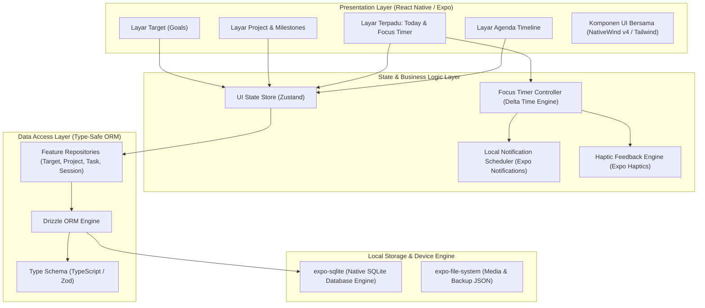

# System Architecture Document — MyLife Mobile

**Versi:** 1.0.0  
**Tipe Aplikasi:** Native Mobile (React Native + Expo)  
**Pola Arsitektur:** Local-First / Offline-First Architecture  

---

## 1. Prinsip & Pola Arsitektur Utama

MyLife Mobile dirancang dengan pendekatan **Local-First Architecture** dengan 4 pilar utama:
1. **Zero-Network Dependency:** Seluruh fungsi pencatatan, timer, perubahan status, dan visualisasi data berjalan langsung pada database lokal di dalam perangkat. Tidak ada *loading spinner* jaringan.
2. **Predictable Data Lifecycle:** Data disimpan dalam basis data relasional SQLite lokal dengan integritas kunci asing (*foreign keys*) dan indeks optimal.
3. **Hardware-Aware Performance:** Memanfaatkan kemampuan perangkat keras secara efisien (getaran haptik, penjagaan layar tetap hidup saat sesi fokus, alarm pengingat OS).
4. **Cloud-Ready Design:** Setiap baris tabel dilengkapi kolom `id` (UUIDv4/CUID), `created_at`, `updated_at`, dan `is_deleted` (soft-delete) sehingga siap disinkronkan ke server cloud di masa depan tanpa perlu mengubah struktur tabel.

---

## 2. Diagram Arsitektur Sistem



---

## 3. Komponen Teknologi (Tech Stack)

| Kebutuhan | Teknologi Pilihan | Alasan Pemilihan |
|---|---|---|
| **Core Framework** | **React Native + Expo SDK 52+** | Ekosistem stabil, kompilasi build APK instan via EAS, dukungan hardware native lengkap. |
| **Navigasi** | **Expo Router v4** | File-based routing (persis seperti Next.js App Router). Mendukung *Tabs* bawah dan *Modals* bertumpuk. |
| **UI Styling** | **NativeWind v4 (Tailwind CSS)** | Menjaga konsistensi palet warna *Obsidian Teal* dan token desain dari versi web sebelumnya. |
| **Database Engine** | **`expo-sqlite` (next/async driver)** | Driver SQLite native resmi tercepat di ekosistem Expo, mendukung transaksi aman dan query batch. |
| **ORM / Query Builder** | **Drizzle ORM** | Sangat ringan (< 30 KB), type-safe 100%, menghasilkan query SQL langsung tanpa overhead tinggi. |
| **State Management** | **Zustand** | Sangat ringan, minim boilerplate, reaktif tanpa re-render berlebihan. |
| **Haptic Feedback** | **`expo-haptics`** | Memberikan umpan balik getaran halus pada jari saat centang to-do atau tombol timer. |
| **Notifikasi Lokal** | **`expo-notifications`** | Menjadwalkan pengingat deadline dan agenda langsung pada sistem alarm OS ponsel tanpa server luar. |
| **Keep Screen Awake** | **`expo-keep-awake`** | Mencegah layar ponsel tidur/mati saat timer fokus Pomodoro sedang berjalan. |
| **Audio Alert** | **`expo-audio` / `expo-av`** | Memutar bunyi lonceng mangkuk meditasi saat interval fokus selesai. |

---

## 4. Strategi Teknis Kunci (Technical Strategies)

### 4.1 Strategi Timer Fokus Latar Belakang (Handling Android Doze Mode)
**Tantangan:** Sistem operasi Android memiliki mekanisme penghemat daya agresif (*Doze Mode*) yang mematikan `setInterval` JavaScript saat aplikasi diminimalkan atau layar dimatikan.  
**Solusi Arsitektural:**
1. **Delta Timestamp Calculation:** Timer dilarang mengandalkan hitungan `secondsLeft = secondsLeft - 1` setiap detik.
2. Timer mencatat waktu mulai pasti: `startedAt = Date.now()` dan `targetDurationMs = 25 * 60 * 1000`.
3. Sisa waktu dihitung dinamis: `remaining = targetDurationMs - (Date.now() - startedAt)`.
4. Saat timer dimulai, aplikasi langsung mendaftarkan **Notifikasi Lokal Terjadwal** di OS Android untuk waktu `startedAt + targetDurationMs`.
5. Jika pengguna meminimalkan aplikasi atau layar mati, OS Android sendiri yang akan membunyikan alarm tepat waktu, bukan proses JavaScript background.

### 4.2 Desain Database & Skema Idempotent
* Setiap baris data memiliki kolom:
  - `id`: Teks UUIDv4 acak (mencegah tabrakan ID jika nanti digabung dengan server).
  - `created_at`: Waktu pembuatan dalam format ISO-8601 UTC string atau integer timestamp milidetik.
  - `updated_at`: Waktu pembaruan terakhir.
  - `is_archived` / `is_deleted`: Soft-delete agar riwayat histori progres tidak putus.
* Penghitungan progres Target dilakukan secara reaktif via query relasi atau trigger lokal.

---

## 5. Struktur Direktori Proyek Mobile Direkomendasikan

```
mylife-mobile/
├── app/                              # Expo Router Screens
│   ├── _layout.tsx                   # Root Provider (DB Init, Themes, Fonts)
│   ├── (tabs)/                       # Bottom Navigation Bar
│   │   ├── _layout.tsx               # Konfigurasi Tab Icons & Styling
│   │   ├── index.tsx                 # Tab 1: Today & Focus Terpadu
│   │   ├── targets/                  # Tab 2: Target & Goals (Fitur Utama)
│   │   │   ├── index.tsx             # Daftar Target aktif per pilar
│   │   │   └── [id].tsx              # Detail Target + Breakdown Proyek
│   │   ├── projects/                 # Tab 3: Proyek & Milestone
│   │   │   ├── index.tsx             # Daftar Proyek
│   │   │   └── [id].tsx              # Detail Proyek & Board Tugas
│   │   └── agenda.tsx                # Tab 4: Timeline Agenda Harian
│   └── modals/                       # Layar Modal / Popup Tambah Cepat
│       ├── new-target.tsx            # Form Tambah Target Baru
│       ├── new-project.tsx           # Form Tambah Proyek Baru
│       ├── new-task.tsx              # Form Tambah Tugas
│       └── session-summary.tsx       # Dialog Refleksi Pasca Sesi Fokus
├── src/
│   ├── components/                   # Reusable UI Components
│   │   ├── ui/                       # Button, Card, Input, ProgressBadge, Modal
│   │   ├── focus/                    # TimerWheel, TimerControls, SessionLogger
│   │   ├── targets/                  # TargetCard, PilarSelector, MetricBar
│   │   └── agenda/                   # TimelineItem, TimeIndicatorLine
│   ├── db/                           # Database Layer
│   │   ├── client.ts                 # Inisialisasi expo-sqlite
│   │   ├── schema.ts                 # Definisi Skema Tabel Drizzle ORM
│   │   ├── migrations/               # File Migrasi SQLite
│   │   └── repositories/             # Data Access Functions (CRUD)
│   │       ├── target.repo.ts
│   │       ├── project.repo.ts
│   │       ├── task.repo.ts
│   │       ├── focus.repo.ts
│   │       └── agenda.repo.ts
│   ├── hooks/                        # Custom Hooks
│   │   ├── useFocusTimer.ts          # State & kontrol timer Pomodoro
│   │   ├── useTodaySchedule.ts       # Hook penggabungan jadwal hari ini
│   │   └── useHaptics.ts             # Shortcut getaran ponsel
│   ├── services/                     # Business Logic
│   │   ├── notification.service.ts   # Penjadwalan notifikasi alarm HP
│   │   └── progress.service.ts       # Rumus kalkulasi persen target & streak
│   └── theme/                        # Design Tokens
│       └── colors.ts                 # Obsidian Teal Palet (#081013, #14b8a6)
├── app.json                          # Konfigurasi Expo & Android Package
├── package.json                      # Dependensi
├── tailwind.config.js                # Konfigurasi NativeWind
└── tsconfig.json                     # Konfigurasi TypeScript
```
