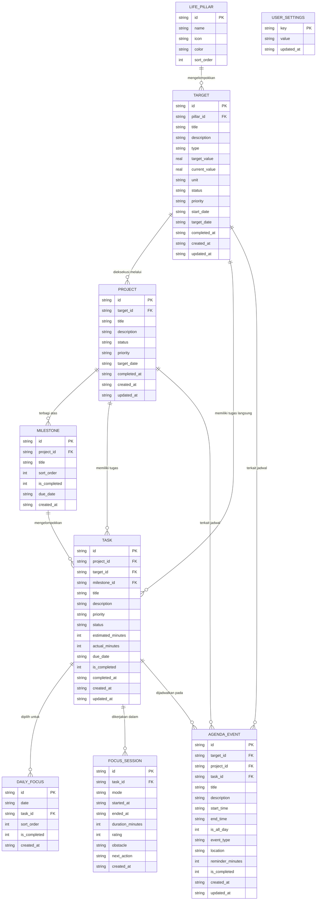

# Database Schema & Data Model Document — MyLife Mobile

**Mesin Database:** SQLite 3 (melalui `expo-sqlite`)  
**ORM:** Drizzle ORM (TypeScript Type-Safe)  
**Tipe Integritas:** Relasional dengan Foreign Keys Aktif (`PRAGMA foreign_keys = ON;`)  

---

## 1. Entity-Relationship Diagram (ERD)



---

## 2. Spesifikasi Detail Tabel

### 2.1 Tabel `life_pillars` (Pilar Kehidupan)
Wadah pengelompokan Target hidup agar terjadi keseimbangan antara karier, keuangan, kesehatan, dan spiritual.
* `id` (TEXT, PK): UUIDv4 atau slug (`career`, `finance`, `health`, `growth`, `personal`).
* `name` (TEXT): Nama pilar (Contoh: "Karier & Bisnis", "Finansial").
* `icon` (TEXT): Nama icon Lucide (Contoh: `briefcase`, `wallet`, `heart-pulse`, `book-open`).
* `color` (TEXT): Hex warna (Contoh: `#14b8a6`, `#f59e0b`, `#3b82f6`).
* `sort_order` (INTEGER): Urutan tampilan di mobile.

---

### 2.2 Tabel `targets` (Target / Goals - Fitur Utama)
Menyimpan tujuan hidup besar yang ingin dicapai.
* `id` (TEXT, PK): UUIDv4.
* `pillar_id` (TEXT, FK -> `life_pillars.id`): Pilar kategori.
* `title` (TEXT): Judul Target.
* `description` (TEXT, NULL): Alasan / visi motivasi target.
* `type` (TEXT): `MILESTONE_BASED` | `NUMERIC` | `MAINTENANCE`.
* `target_value` (REAL, DEFAULT 100.0): Nilai sasaran akhir (misal: 100.0 atau 50000000).
* `current_value` (REAL, DEFAULT 0.0): Nilai pencapaian saat ini.
* `unit` (TEXT, DEFAULT '%'): Satuan target (`%`, `buku`, `kg`, `rupiah`).
* `status` (TEXT): `ACTIVE` | `PAUSED` | `COMPLETED` | `CANCELLED`.
* `priority` (TEXT): `LOW` | `MEDIUM` | `HIGH` | `URGENT`.
* `start_date` (TEXT, ISO-8601): Tanggal mulai target.
* `target_date` (TEXT, ISO-8601, NULL): Tenggat waktu pencapaian target.
* `completed_at` (TEXT, ISO-8601, NULL): Waktu penyelesaian.
* `created_at` (TEXT, ISO-8601): Waktu dibuat.
* `updated_at` (TEXT, ISO-8601): Waktu diperbarui.

---

### 2.3 Tabel `projects` (Proyek Pendukung Target)
Wadah eksekusi kerja spesifik yang bermuara pada satu Target.
* `id` (TEXT, PK): UUIDv4.
* `target_id` (TEXT, NULL, FK -> `targets.id` ON DELETE SET NULL).
* `title` (TEXT): Nama proyek.
* `description` (TEXT, NULL): Penjelasan cakupan proyek.
* `status` (TEXT): `PLANNING` | `ACTIVE` | `ON_HOLD` | `COMPLETED`.
* `priority` (TEXT): `LOW` | `MEDIUM` | `HIGH`.
* `target_date` (TEXT, NULL): Batas akhir proyek.
* `completed_at` (TEXT, NULL).
* `created_at` (TEXT): Timestamp.
* `updated_at` (TEXT): Timestamp.

---

### 2.4 Tabel `milestones` (Fase Kerja Proyek)
* `id` (TEXT, PK): UUIDv4.
* `project_id` (TEXT, FK -> `projects.id` ON DELETE CASCADE).
* `title` (TEXT): Judul fase/tahapan kerja.
* `sort_order` (INTEGER): Urutan fase kerja.
* `is_completed` (INTEGER, DEFAULT 0): `1` jika selesai, `0` jika aktif.
* `due_date` (TEXT, NULL): Target waktu fase.
* `created_at` (TEXT).

---

### 2.5 Tabel `tasks` (Tugas Konkret)
Unit kerja paling dasar yang bisa dikerjakan, difokuskan, dan dicentang.
* `id` (TEXT, PK): UUIDv4.
* `project_id` (TEXT, NULL, FK -> `projects.id` ON DELETE CASCADE).
* `target_id` (TEXT, NULL, FK -> `targets.id` ON DELETE SET NULL).
* `milestone_id` (TEXT, NULL, FK -> `milestones.id` ON DELETE SET NULL).
* `title` (TEXT): Judul tugas.
* `description` (TEXT, NULL): Catatan atau checklist langkah kecil.
* `priority` (TEXT): `LOW` | `MEDIUM` | `HIGH` | `URGENT`.
* `status` (TEXT): `TODO` | `IN_PROGRESS` | `COMPLETED` | `CANCELLED`.
* `estimated_minutes` (INTEGER, DEFAULT 25): Estimasi waktu pengerjaan.
* `actual_minutes` (INTEGER, DEFAULT 0): Akumulasi waktu fokus yang berhasil direkam.
* `due_date` (TEXT, NULL): Batas akhir tugas.
* `is_completed` (INTEGER, DEFAULT 0): `1` jika selesai.
* `completed_at` (TEXT, NULL).
* `created_at` (TEXT).
* `updated_at` (TEXT).

---

### 2.6 Tabel `daily_focus_items` (Tugas Prioritas Hari Ini)
Menghubungkan tugas-tugas terpilih yang menjadi komitmen hari ini (maksimal 3 - 5 item).
* `id` (TEXT, PK): UUIDv4.
* `date` (TEXT): Tanggal dalam format `YYYY-MM-DD` (Local date).
* `task_id` (TEXT, FK -> `tasks.id` ON DELETE CASCADE).
* `sort_order` (INTEGER, DEFAULT 0): Urutan prioritas (1 s/d 5).
* `is_completed` (INTEGER, DEFAULT 0).
* `created_at` (TEXT).

---

### 2.7 Tabel `focus_sessions` (Riwayat Sesi Timer Fokus)
Menyimpan log setiap kali pengguna menyalakan timer fokus (Pomodoro atau Deep Flow).
* `id` (TEXT, PK): UUIDv4.
* `task_id` (TEXT, NULL, FK -> `tasks.id` ON DELETE SET NULL): Tugas yang dikerjakan.
* `mode` (TEXT): `POMODORO` | `DEEP_FLOW` | `STOPWATCH`.
* `started_at` (TEXT, ISO-8601): Waktu mulai sesi.
* `ended_at` (TEXT, ISO-8601, NULL): Waktu selesai sesi.
* `duration_minutes` (INTEGER): Menit fokus bersih yang terselesaikan.
* `rating` (INTEGER, NULL): Skala pemahaman/kepuasan fokus (1 - 5 bintang).
* `obstacle` (TEXT, NULL): Hambatan / distraksi yang dialami.
* `next_action` (TEXT, NULL): Langkah berikutnya pasca istirahat.
* `created_at` (TEXT).

---

### 2.8 Tabel `agenda_events` (Jadwal & Agenda Waktu)
Timeline kronologis kegiatan hari ini dan hari mendatang.
* `id` (TEXT, PK): UUIDv4.
* `target_id` (TEXT, NULL, FK -> `targets.id` ON DELETE SET NULL).
* `project_id` (TEXT, NULL, FK -> `projects.id` ON DELETE SET NULL).
* `task_id` (TEXT, NULL, FK -> `tasks.id` ON DELETE SET NULL).
* `title` (TEXT): Judul acara/agenda.
* `description` (TEXT, NULL).
* `start_time` (TEXT, ISO-8601): Waktu mulai acara.
* `end_time` (TEXT, ISO-8601): Waktu selesai acara.
* `is_all_day` (INTEGER, DEFAULT 0): `1` jika to-do bebas jam.
* `event_type` (TEXT): `WORK` | `PERSONAL` | `LEARNING` | `MEETING`.
* `location` (TEXT, NULL).
* `reminder_minutes` (INTEGER, DEFAULT 10): Waktu pengingat sebelum mulai.
* `is_completed` (INTEGER, DEFAULT 0).
* `created_at` (TEXT).
* `updated_at` (TEXT).

---

### 2.9 Tabel `user_settings` (Pengaturan Lokal Key-Value)
* `key` (TEXT, PK): Identifier konfigurasi (Contoh: `theme`, `pomo_work_min`, `pomo_break_min`, `haptics_enabled`).
* `value` (TEXT): Nilai konfigurasi dalam format JSON string / text.
* `updated_at` (TEXT).

---

## 3. Strategi Indexing SQLite (Performa 60 FPS di Ponsel)

Untuk memastikan query tetap responsif instan di HP Android tanpa lag:
```sql
-- Index pencarian target berdasarkan status & pilar
CREATE INDEX idx_targets_pillar_status ON targets(pillar_id, status);
CREATE INDEX idx_targets_updated_at ON targets(updated_at DESC);

-- Index tugas untuk layar Today & Project
CREATE INDEX idx_tasks_project_id ON tasks(project_id);
CREATE INDEX idx_tasks_target_id ON tasks(target_id);
CREATE INDEX idx_tasks_status ON tasks(status);
CREATE INDEX idx_tasks_due_date ON tasks(due_date);

-- Index fokus harian per tanggal
CREATE UNIQUE INDEX idx_daily_focus_unique ON daily_focus_items(date, task_id);
CREATE INDEX idx_daily_focus_date ON daily_focus_items(date);

-- Index riwayat sesi fokus per tugas dan waktu
CREATE INDEX idx_focus_sessions_task ON focus_sessions(task_id);
CREATE INDEX idx_focus_sessions_started_at ON focus_sessions(started_at DESC);

-- Index timeline agenda berdasarkan rentang waktu
CREATE INDEX idx_agenda_time_range ON agenda_events(start_time, end_time);
```

---

## 4. DDL Skrip SQL Pembuatan Tabel Lengkap

```sql
PRAGMA foreign_keys = ON;

-- 1. Pillars
CREATE TABLE IF NOT EXISTS life_pillars (
    id TEXT PRIMARY KEY,
    name TEXT NOT NULL,
    icon TEXT NOT NULL,
    color TEXT NOT NULL,
    sort_order INTEGER NOT NULL DEFAULT 0
);

-- 2. Targets (Goals)
CREATE TABLE IF NOT EXISTS targets (
    id TEXT PRIMARY KEY,
    pillar_id TEXT NOT NULL REFERENCES life_pillars(id) ON DELETE RESTRICT,
    title TEXT NOT NULL,
    description TEXT,
    type TEXT NOT NULL DEFAULT 'MILESTONE_BASED',
    target_value REAL NOT NULL DEFAULT 100.0,
    current_value REAL NOT NULL DEFAULT 0.0,
    unit TEXT NOT NULL DEFAULT '%',
    status TEXT NOT NULL DEFAULT 'ACTIVE',
    priority TEXT NOT NULL DEFAULT 'MEDIUM',
    start_date TEXT NOT NULL,
    target_date TEXT,
    completed_at TEXT,
    created_at TEXT NOT NULL,
    updated_at TEXT NOT NULL
);

-- 3. Projects
CREATE TABLE IF NOT EXISTS projects (
    id TEXT PRIMARY KEY,
    target_id TEXT REFERENCES targets(id) ON DELETE SET NULL,
    title TEXT NOT NULL,
    description TEXT,
    status TEXT NOT NULL DEFAULT 'ACTIVE',
    priority TEXT NOT NULL DEFAULT 'MEDIUM',
    target_date TEXT,
    completed_at TEXT,
    created_at TEXT NOT NULL,
    updated_at TEXT NOT NULL
);

-- 4. Milestones
CREATE TABLE IF NOT EXISTS milestones (
    id TEXT PRIMARY KEY,
    project_id TEXT NOT NULL REFERENCES projects(id) ON DELETE CASCADE,
    title TEXT NOT NULL,
    sort_order INTEGER NOT NULL DEFAULT 0,
    is_completed INTEGER NOT NULL DEFAULT 0,
    due_date TEXT,
    created_at TEXT NOT NULL
);

-- 5. Tasks
CREATE TABLE IF NOT EXISTS tasks (
    id TEXT PRIMARY KEY,
    project_id TEXT REFERENCES projects(id) ON DELETE CASCADE,
    target_id TEXT REFERENCES targets(id) ON DELETE SET NULL,
    milestone_id TEXT REFERENCES milestones(id) ON DELETE SET NULL,
    title TEXT NOT NULL,
    description TEXT,
    priority TEXT NOT NULL DEFAULT 'MEDIUM',
    status TEXT NOT NULL DEFAULT 'TODO',
    estimated_minutes INTEGER NOT NULL DEFAULT 25,
    actual_minutes INTEGER NOT NULL DEFAULT 0,
    due_date TEXT,
    is_completed INTEGER NOT NULL DEFAULT 0,
    completed_at TEXT,
    created_at TEXT NOT NULL,
    updated_at TEXT NOT NULL
);

-- 6. Daily Focus
CREATE TABLE IF NOT EXISTS daily_focus_items (
    id TEXT PRIMARY KEY,
    date TEXT NOT NULL,
    task_id TEXT NOT NULL REFERENCES tasks(id) ON DELETE CASCADE,
    sort_order INTEGER NOT NULL DEFAULT 0,
    is_completed INTEGER NOT NULL DEFAULT 0,
    created_at TEXT NOT NULL
);

-- 7. Focus Sessions
CREATE TABLE IF NOT EXISTS focus_sessions (
    id TEXT PRIMARY KEY,
    task_id TEXT REFERENCES tasks(id) ON DELETE SET NULL,
    mode TEXT NOT NULL DEFAULT 'POMODORO',
    started_at TEXT NOT NULL,
    ended_at TEXT,
    duration_minutes INTEGER NOT NULL DEFAULT 0,
    rating INTEGER,
    obstacle TEXT,
    next_action TEXT,
    created_at TEXT NOT NULL
);

-- 8. Agenda Events
CREATE TABLE IF NOT EXISTS agenda_events (
    id TEXT PRIMARY KEY,
    target_id TEXT REFERENCES targets(id) ON DELETE SET NULL,
    project_id TEXT REFERENCES projects(id) ON DELETE SET NULL,
    task_id TEXT REFERENCES tasks(id) ON DELETE SET NULL,
    title TEXT NOT NULL,
    description TEXT,
    start_time TEXT NOT NULL,
    end_time TEXT NOT NULL,
    is_all_day INTEGER NOT NULL DEFAULT 0,
    event_type TEXT NOT NULL DEFAULT 'WORK',
    location TEXT,
    reminder_minutes INTEGER DEFAULT 10,
    is_completed INTEGER NOT NULL DEFAULT 0,
    created_at TEXT NOT NULL,
    updated_at TEXT NOT NULL
);

-- 9. User Settings
CREATE TABLE IF NOT EXISTS user_settings (
    key TEXT PRIMARY KEY,
    value TEXT NOT NULL,
    updated_at TEXT NOT NULL
);
```

---

## 5. Seed Data Awal (Default Life Pillars)

Saat aplikasi pertama kali dibuka di HP, jalankan insert pilar kehidupan standar:
```sql
INSERT OR IGNORE INTO life_pillars (id, name, icon, color, sort_order) VALUES
('career', 'Karier & Bisnis', 'briefcase', '#14b8a6', 1),
('finance', 'Finansial & Aset', 'wallet', '#f59e0b', 2),
('health', 'Kesehatan & Fisik', 'heart-pulse', '#ef4444', 3),
('growth', 'Pengembangan Diri', 'book-open', '#8b5cf6', 4),
('personal', 'Pribadi & Hubungan', 'users', '#3b82f6', 5);
```
